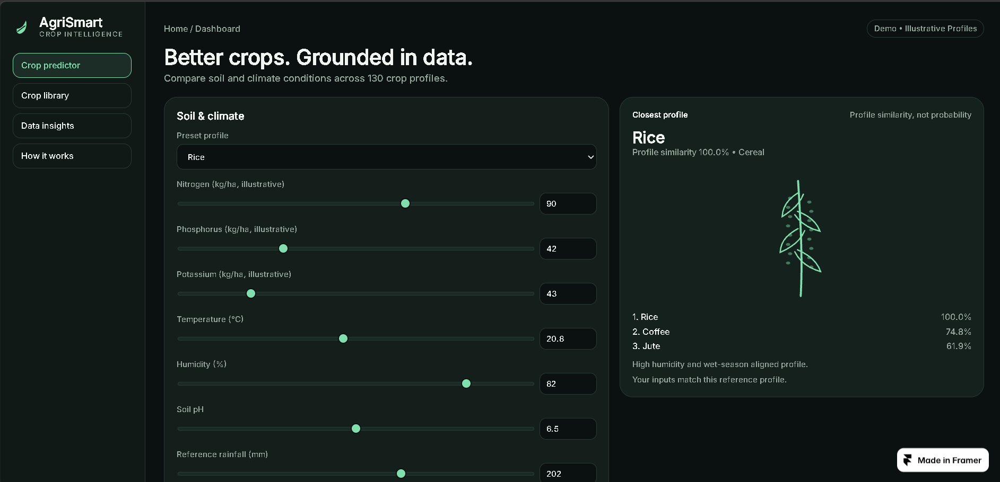

# 🌱 AgriSmart – Crop Intelligence

### Better Crops. Grounded in Data.

AgriSmart is a web-based crop recommendation application designed to help users explore suitable crops based on soil and environmental parameters.

## 📸 Project Preview

## ✨ Features

- 🌱 Crop Predictor Dashboard
- 🌾 Crop Profile Library
- 📊 Data Insights
- 🌡️ Soil and Climate Parameters
- 🔍 Crop Profile Similarity Comparison
- ✅ Input Validation

## ⚙️ Parameters

The application uses seven illustrative parameters:

- Nitrogen
- Phosphorus
- Potassium
- Temperature
- Humidity
- Soil pH
- Rainfall

## 🎯 Project Objective

To demonstrate how soil and climate conditions can be compared with crop reference profiles to identify suitable crop recommendations.

## 📊 Recommendation System

The application compares user inputs with predefined crop profiles and displays the closest matching profiles.

Note: This is a front-end demonstration using illustrative profiles. Similarity scores are not prediction probabilities or measured model accuracy.

## 🚀 Future Enhancements

- Integration with real agricultural datasets
- Machine learning-based recommendations
- Live weather data integration
- Database connectivity
- Improved crop analytics

## 👨‍💻 Author

**Rasoolkhan**

BCA Student | Aspiring Developer

---

⭐ If you find this project interesting, consider giving it a star!
